# Tile-Based Selective Weight Loading Accounting for SSD Throughput Saturation

## 1. Research Background and Objectives

### 1.1 A Study of SSD Architecture by Jeong et al. (2013)

According to Jeong et al. (2013), flash memory, unlike HDDs, can access data quickly regardless of its physical location, offering consistently fast random access. However, the sustained read/write speed of a single flash memory device is lower than that of an HDD. To compensate, most SSDs adopt multichannel and multiway architectures.

The researchers used IOMeter to measure how HDD and SSD throughput varies with request size. For both SSD reads and writes, throughput—the amount of data processed per unit time—increased with request size until it stopped increasing beyond a certain size. This occurs because larger requests allow the SSD to use its multiple channels in parallel, eventually reaching maximum channel utilization.

The researchers analyzed how this throughput saturation differs between SSD writes and reads. For writes, sequential access achieved higher throughput than random access. For reads, however, sequential and random access reached saturation at similar request sizes and exhibited similar throughput levels at saturation.

### 1.2 A Study of I/O-Efficient Sparsification by Lee et al. (2025)

A challenge in running models such as LLMs on portable hardware is that the device often lacks enough DRAM to hold the entire model. Research on activation sparsification has explored storing weights in flash memory and loading only rows predicted to be important into DRAM.

Lee et al. (2025) questioned the assumption underlying existing methods that I/O latency increases in proportion to the amount of data requested. Even when reading the same amount of weights, throughput can decrease if the selected rows are sparsely distributed over a wide range. The paper argues that this effect may be more pronounced for models such as VLMs, whose channel importance is uniformly distributed.

The researchers therefore defined a chunk-based latency model that predicts read latency by accounting for the physical contiguity of weight rows, and proposed Neuron Chunking, a selection method based on importance and latency.

Let <picture><source media="(prefers-color-scheme: dark)" srcset="report/images/readme-math-001-dark.svg">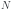</picture> be the number of weight rows and <picture><source media="(prefers-color-scheme: dark)" srcset="report/images/readme-math-002-dark.svg">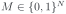</picture> be a selection mask. If <picture><source media="(prefers-color-scheme: dark)" srcset="report/images/readme-math-003-dark.svg"></picture>, row <picture><source media="(prefers-color-scheme: dark)" srcset="report/images/readme-math-004-dark.svg">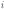</picture> is read. For an input containing <picture><source media="(prefers-color-scheme: dark)" srcset="report/images/readme-math-005-dark.svg">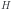</picture> tokens, the importance of channel <picture><source media="(prefers-color-scheme: dark)" srcset="report/images/readme-math-004-dark.svg"></picture> and the importance retained by the mask are defined as follows.

<picture><source media="(prefers-color-scheme: dark)" srcset="report/images/readme-math-006-dark.svg">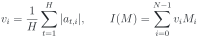</picture>

Here, <picture><source media="(prefers-color-scheme: dark)" srcset="report/images/readme-math-007-dark.svg">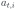</picture> is the activation of channel <picture><source media="(prefers-color-scheme: dark)" srcset="report/images/readme-math-004-dark.svg"></picture> for token <picture><source media="(prefers-color-scheme: dark)" srcset="report/images/readme-math-008-dark.svg">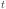</picture>.

Decompose the rows selected by mask <picture><source media="(prefers-color-scheme: dark)" srcset="report/images/readme-math-009-dark.svg"></picture> into maximal contiguous intervals, and denote their set by <picture><source media="(prefers-color-scheme: dark)" srcset="report/images/readme-math-010-dark.svg">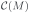</picture>. Let <picture><source media="(prefers-color-scheme: dark)" srcset="report/images/readme-math-011-dark.svg">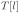</picture> be the latency cost of reading an interval of <picture><source media="(prefers-color-scheme: dark)" srcset="report/images/readme-math-012-dark.svg">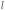</picture> rows. The original paper's chunk-based latency model is

<picture><source media="(prefers-color-scheme: dark)" srcset="report/images/readme-math-013-dark.svg">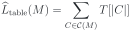</picture>

For each interval length <picture><source media="(prefers-color-scheme: dark)" srcset="report/images/readme-math-012-dark.svg"></picture>, the researchers measured <picture><source media="(prefers-color-scheme: dark)" srcset="report/images/readme-math-011-dark.svg"></picture> by reading enough chunks of the same size for throughput to stabilize. The definition of <picture><source media="(prefers-color-scheme: dark)" srcset="report/images/readme-math-014-dark.svg"></picture> provides an approximation of the time required to read the weights selected by <picture><source media="(prefers-color-scheme: dark)" srcset="report/images/readme-math-009-dark.svg"></picture> from flash memory.

The researchers formulated the problem of finding a mask <picture><source media="(prefers-color-scheme: dark)" srcset="report/images/readme-math-009-dark.svg"></picture> that maximizes retained importance per unit of estimated latency under a row budget <picture><source media="(prefers-color-scheme: dark)" srcset="report/images/readme-math-015-dark.svg">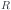</picture>.

<picture><source media="(prefers-color-scheme: dark)" srcset="report/images/readme-math-016-dark.svg">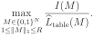</picture>

To construct a mask <picture><source media="(prefers-color-scheme: dark)" srcset="report/images/readme-math-009-dark.svg"></picture> with a high importance-to-latency ratio, the paper's greedy algorithm generates a set <picture><source media="(prefers-color-scheme: dark)" srcset="report/images/readme-math-017-dark.svg">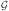</picture> of candidate contiguous intervals. For each candidate <picture><source media="(prefers-color-scheme: dark)" srcset="report/images/readme-math-018-dark.svg">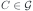</picture>, it computes

<picture><source media="(prefers-color-scheme: dark)" srcset="report/images/readme-math-019-dark.svg"></picture>

Candidates are considered in descending order of score. The mask is updated by selecting intervals that neither overlap previously selected rows nor exceed the remaining budget.

Define a candidate interval starting at row <picture><source media="(prefers-color-scheme: dark)" srcset="report/images/readme-math-020-dark.svg">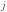</picture> with length <picture><source media="(prefers-color-scheme: dark)" srcset="report/images/readme-math-021-dark.svg">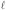</picture> as follows.

<picture><source media="(prefers-color-scheme: dark)" srcset="report/images/readme-math-022-dark.svg"></picture>

Let <picture><source media="(prefers-color-scheme: dark)" srcset="report/images/readme-math-023-dark.svg"></picture> denote the minimum and maximum candidate lengths in rows, respectively, <picture><source media="(prefers-color-scheme: dark)" srcset="report/images/readme-math-024-dark.svg">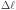</picture> the length increment, and <picture><source media="(prefers-color-scheme: dark)" srcset="report/images/readme-math-025-dark.svg">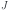</picture> the upper bound on the step between starting positions. The paper considers the following <picture><source media="(prefers-color-scheme: dark)" srcset="report/images/readme-math-026-dark.svg">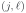</picture> pairs when constructing the candidate set <picture><source media="(prefers-color-scheme: dark)" srcset="report/images/readme-math-017-dark.svg"></picture>.

<picture><source media="(prefers-color-scheme: dark)" srcset="report/images/readme-math-027-dark.svg">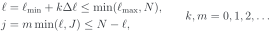</picture>

This rule allows candidates of the same length to overlap when <picture><source media="(prefers-color-scheme: dark)" srcset="report/images/readme-math-028-dark.svg">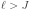</picture>. The maximum length <picture><source media="(prefers-color-scheme: dark)" srcset="report/images/readme-math-029-dark.svg"></picture> is determined by the device's throughput saturation point, while <picture><source media="(prefers-color-scheme: dark)" srcset="report/images/readme-math-030-dark.svg"></picture>, <picture><source media="(prefers-color-scheme: dark)" srcset="report/images/readme-math-024-dark.svg"></picture>, and <picture><source media="(prefers-color-scheme: dark)" srcset="report/images/readme-math-025-dark.svg"></picture> control the granularity and computational cost of the search.

## 2. Problem Formulation and Proposed Method

### 2.1 The Actual Optimal Solution to the Paper's Formulation

Consider the Neuron Chunking problem formulated in the paper.

<picture><source media="(prefers-color-scheme: dark)" srcset="report/images/readme-math-016-dark.svg"></picture>

Assume <picture><source media="(prefers-color-scheme: dark)" srcset="report/images/readme-math-031-dark.svg">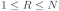</picture> and <picture><source media="(prefers-color-scheme: dark)" srcset="report/images/readme-math-032-dark.svg">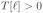</picture> for every length <picture><source media="(prefers-color-scheme: dark)" srcset="report/images/readme-math-033-dark.svg">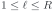</picture>.

Let <picture><source media="(prefers-color-scheme: dark)" srcset="report/images/readme-math-034-dark.svg"></picture> be any optimal mask under the row budget <picture><source media="(prefers-color-scheme: dark)" srcset="report/images/readme-math-035-dark.svg">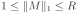</picture>. Since the intervals in <picture><source media="(prefers-color-scheme: dark)" srcset="report/images/readme-math-036-dark.svg">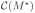</picture> partition the selected rows, we have

<picture><source media="(prefers-color-scheme: dark)" srcset="report/images/readme-math-037-dark.svg">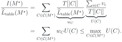</picture>

Since <picture><source media="(prefers-color-scheme: dark)" srcset="report/images/readme-math-038-dark.svg">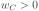</picture> and <picture><source media="(prefers-color-scheme: dark)" srcset="report/images/readme-math-039-dark.svg">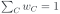</picture>, the overall ratio is a latency-weighted average of the individual interval ratios. It therefore cannot exceed the largest interval ratio.

Let <picture><source media="(prefers-color-scheme: dark)" srcset="report/images/readme-math-040-dark.svg">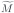</picture> be the mask that retains only the interval <picture><source media="(prefers-color-scheme: dark)" srcset="report/images/readme-math-041-dark.svg"></picture> with the largest <picture><source media="(prefers-color-scheme: dark)" srcset="report/images/readme-math-042-dark.svg">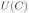</picture>. Since

<picture><source media="(prefers-color-scheme: dark)" srcset="report/images/readme-math-043-dark.svg">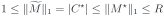</picture>

the mask <picture><source media="(prefers-color-scheme: dark)" srcset="report/images/readme-math-040-dark.svg"></picture> also satisfies the row budget. By the preceding inequality, the ratio of <picture><source media="(prefers-color-scheme: dark)" srcset="report/images/readme-math-040-dark.svg"></picture> is no smaller than that of <picture><source media="(prefers-color-scheme: dark)" srcset="report/images/readme-math-034-dark.svg"></picture>, and by the optimality of <picture><source media="(prefers-color-scheme: dark)" srcset="report/images/readme-math-034-dark.svg"></picture>, it cannot be larger either. Thus, <picture><source media="(prefers-color-scheme: dark)" srcset="report/images/readme-math-040-dark.svg"></picture> is also optimal.

An optimal solution consisting of a single contiguous interval therefore exists. The original problem reduces to finding the interval that maximizes <picture><source media="(prefers-color-scheme: dark)" srcset="report/images/readme-math-042-dark.svg"></picture> among all contiguous intervals of length at most <picture><source media="(prefers-color-scheme: dark)" srcset="report/images/readme-math-015-dark.svg"></picture>.

<picture><source media="(prefers-color-scheme: dark)" srcset="report/images/readme-math-044-dark.svg">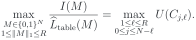</picture>

The maximization on the right ranges over all contiguous intervals, not just those in the candidate set <picture><source media="(prefers-color-scheme: dark)" srcset="report/images/readme-math-017-dark.svg"></picture>.

This occurs because the formulation only imposes an upper bound on the number of selected rows, rather than requiring exactly <picture><source media="(prefers-color-scheme: dark)" srcset="report/images/readme-math-015-dark.svg"></picture> rows. This study therefore considers the more restrictive problem of selecting exactly <picture><source media="(prefers-color-scheme: dark)" srcset="report/images/readme-math-015-dark.svg"></picture> rows.

<picture><source media="(prefers-color-scheme: dark)" srcset="report/images/readme-math-045-dark.svg">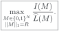</picture>

### 2.2 Two-Line Latency Model

#### 2.2.1 Read Cost of a Contiguous Interval

SSD throughput tends to increase with request size until it saturates at a certain level. Let <picture><source media="(prefers-color-scheme: dark)" srcset="report/images/readme-math-046-dark.svg"></picture> be the per-row read cost in the saturated regime. The latency of an I/O request spanning <picture><source media="(prefers-color-scheme: dark)" srcset="report/images/readme-math-021-dark.svg"></picture> rows can then be approximated as follows.

<picture><source media="(prefers-color-scheme: dark)" srcset="report/images/readme-math-047-dark.svg">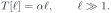</picture>

To also capture the reduced throughput of small requests, this study approximates the measured table <picture><source media="(prefers-color-scheme: dark)" srcset="report/images/readme-math-048-dark.svg">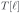</picture> using the following two-line model.

Let <picture><source media="(prefers-color-scheme: dark)" srcset="report/images/readme-math-049-dark.svg"></picture> be the cost of an interval of <picture><source media="(prefers-color-scheme: dark)" srcset="report/images/readme-math-021-dark.svg"></picture> rows. With a transition point <picture><source media="(prefers-color-scheme: dark)" srcset="report/images/readme-math-050-dark.svg">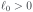</picture> expressed in rows and an additional cost coefficient <picture><source media="(prefers-color-scheme: dark)" srcset="report/images/readme-math-051-dark.svg"></picture>, the model is

<picture><source media="(prefers-color-scheme: dark)" srcset="report/images/readme-math-052-dark.svg">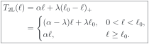</picture>

Here, <picture><source media="(prefers-color-scheme: dark)" srcset="report/images/readme-math-053-dark.svg">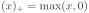</picture>. When there are no rows to read, we separately define <picture><source media="(prefers-color-scheme: dark)" srcset="report/images/readme-math-054-dark.svg">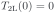</picture>.

The two lines meet continuously at <picture><source media="(prefers-color-scheme: dark)" srcset="report/images/readme-math-055-dark.svg">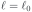</picture>, and the throughput in rows per unit time is given by

<picture><source media="(prefers-color-scheme: dark)" srcset="report/images/readme-math-056-dark.svg">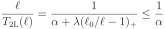</picture>

If <picture><source media="(prefers-color-scheme: dark)" srcset="report/images/readme-math-057-dark.svg">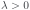</picture>, throughput increases with interval length before the transition point and remains constant at <picture><source media="(prefers-color-scheme: dark)" srcset="report/images/readme-math-058-dark.svg">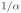</picture> thereafter.

The coefficients <picture><source media="(prefers-color-scheme: dark)" srcset="report/images/readme-math-059-dark.svg"></picture> and the transition point <picture><source media="(prefers-color-scheme: dark)" srcset="report/images/readme-math-060-dark.svg">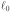</picture> are determined by fitting the model to measured SSD read costs.

#### 2.2.2 Total Read Cost under a Fixed Row Budget

We now use this model to examine the total read cost of a mask <picture><source media="(prefers-color-scheme: dark)" srcset="report/images/readme-math-009-dark.svg"></picture> that selects exactly <picture><source media="(prefers-color-scheme: dark)" srcset="report/images/readme-math-015-dark.svg"></picture> rows. Even when the number of selected rows is fixed, the cost depends on how they form contiguous intervals. The two-line model expresses this difference as the additional cost of short intervals.

Apply the two-line model to the prior work's additive interval-cost structure. Since <picture><source media="(prefers-color-scheme: dark)" srcset="report/images/readme-math-061-dark.svg">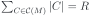</picture>, the total cost decomposes as follows.

<picture><source media="(prefers-color-scheme: dark)" srcset="report/images/readme-math-062-dark.svg">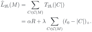</picture>

For a fixed <picture><source media="(prefers-color-scheme: dark)" srcset="report/images/readme-math-015-dark.svg"></picture>, differences in model cost are therefore determined by the length shortfalls of intervals shorter than the transition point. Each interval's additional cost decreases as its length approaches <picture><source media="(prefers-color-scheme: dark)" srcset="report/images/readme-math-060-dark.svg"></picture>, and becomes zero once that length is reached.

This decomposition also yields a lower bound on cost under a fixed row budget. Since every interval has length at most <picture><source media="(prefers-color-scheme: dark)" srcset="report/images/readme-math-015-dark.svg"></picture>, we have <picture><source media="(prefers-color-scheme: dark)" srcset="report/images/readme-math-063-dark.svg">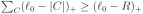</picture>, and hence

<picture><source media="(prefers-color-scheme: dark)" srcset="report/images/readme-math-064-dark.svg"></picture>

A single interval of length <picture><source media="(prefers-color-scheme: dark)" srcset="report/images/readme-math-015-dark.svg"></picture> attains this lower bound. When <picture><source media="(prefers-color-scheme: dark)" srcset="report/images/readme-math-057-dark.svg"></picture> and <picture><source media="(prefers-color-scheme: dark)" srcset="report/images/readme-math-065-dark.svg">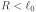</picture>, only a single interval attains it. When <picture><source media="(prefers-color-scheme: dark)" srcset="report/images/readme-math-066-dark.svg"></picture>, any mask whose intervals all have length at least <picture><source media="(prefers-color-scheme: dark)" srcset="report/images/readme-math-060-dark.svg"></picture> attains the bound. Thus, even if the selected rows form multiple intervals, the model cost remains <picture><source media="(prefers-color-scheme: dark)" srcset="report/images/readme-math-067-dark.svg"></picture> as long as every interval is sufficiently long.

Changing which rows are selected also changes the retained importance <picture><source media="(prefers-color-scheme: dark)" srcset="report/images/readme-math-068-dark.svg"></picture>. The next section therefore solves the following optimization problem, which accounts for both importance and the additional cost of short intervals.

<picture><source media="(prefers-color-scheme: dark)" srcset="report/images/readme-math-069-dark.svg"></picture>

### 2.3 Finding the Optimal Mask Using Dynamic Programming

Consider the problem of selecting exactly <picture><source media="(prefers-color-scheme: dark)" srcset="report/images/readme-math-015-dark.svg"></picture> rows under the two-line cost model defined in the previous section. For brevity, write <picture><source media="(prefers-color-scheme: dark)" srcset="report/images/readme-math-070-dark.svg"></picture> and <picture><source media="(prefers-color-scheme: dark)" srcset="report/images/readme-math-071-dark.svg"></picture>, and define the optimal ratio as

<picture><source media="(prefers-color-scheme: dark)" srcset="report/images/readme-math-072-dark.svg"></picture>

Here, <picture><source media="(prefers-color-scheme: dark)" srcset="report/images/readme-math-031-dark.svg"></picture> and <picture><source media="(prefers-color-scheme: dark)" srcset="report/images/readme-math-073-dark.svg"></picture>. Under the coefficient conditions in the previous section, every feasible mask has cost <picture><source media="(prefers-color-scheme: dark)" srcset="report/images/readme-math-074-dark.svg"></picture>.

For a fixed ratio estimate <picture><source media="(prefers-color-scheme: dark)" srcset="report/images/readme-math-075-dark.svg"></picture>, the following additive objective can be maximized using dynamic programming (DP).

<picture><source media="(prefers-color-scheme: dark)" srcset="report/images/readme-math-076-dark.svg"></picture>

We first describe how to solve this problem for a fixed <picture><source media="(prefers-color-scheme: dark)" srcset="report/images/readme-math-075-dark.svg"></picture>, then explain how to use the DP results to find <picture><source media="(prefers-color-scheme: dark)" srcset="report/images/readme-math-077-dark.svg"></picture>.

#### 2.3.1 DP for a Fixed <picture><source media="(prefers-color-scheme: dark)" srcset="report/images/readme-math-075-dark.svg"></picture>

Index the rows by <picture><source media="(prefers-color-scheme: dark)" srcset="report/images/readme-math-078-dark.svg"></picture> and define the importance prefix sums as <picture><source media="(prefers-color-scheme: dark)" srcset="report/images/readme-math-079-dark.svg"></picture>, with <picture><source media="(prefers-color-scheme: dark)" srcset="report/images/readme-math-080-dark.svg"></picture>. Let <picture><source media="(prefers-color-scheme: dark)" srcset="report/images/readme-math-081-dark.svg"></picture> be the maximum value of <picture><source media="(prefers-color-scheme: dark)" srcset="report/images/readme-math-082-dark.svg"></picture> when <picture><source media="(prefers-color-scheme: dark)" srcset="report/images/readme-math-083-dark.svg"></picture> rows are excluded and <picture><source media="(prefers-color-scheme: dark)" srcset="report/images/readme-math-084-dark.svg"></picture> rows are selected from the first <picture><source media="(prefers-color-scheme: dark)" srcset="report/images/readme-math-085-dark.svg"></picture> rows. The required state ranges are <picture><source media="(prefers-color-scheme: dark)" srcset="report/images/readme-math-086-dark.svg"></picture> and <picture><source media="(prefers-color-scheme: dark)" srcset="report/images/readme-math-087-dark.svg"></picture>.

For a mask with <picture><source media="(prefers-color-scheme: dark)" srcset="report/images/readme-math-088-dark.svg"></picture>, split it at the last unselected row. If <picture><source media="(prefers-color-scheme: dark)" srcset="report/images/readme-math-008-dark.svg"></picture> rows are selected before that row, the prefix contains <picture><source media="(prefers-color-scheme: dark)" srcset="report/images/readme-math-089-dark.svg"></picture> excluded rows and <picture><source media="(prefers-color-scheme: dark)" srcset="report/images/readme-math-008-dark.svg"></picture> selected rows. The last excluded row has index <picture><source media="(prefers-color-scheme: dark)" srcset="report/images/readme-math-090-dark.svg"></picture>, and the suffix <picture><source media="(prefers-color-scheme: dark)" srcset="report/images/readme-math-091-dark.svg"></picture> is a contiguous selected interval of length <picture><source media="(prefers-color-scheme: dark)" srcset="report/images/readme-math-092-dark.svg"></picture>.

Because the excluded row separates the prefix from the final interval, their costs can be added. The importance of the final interval is <picture><source media="(prefers-color-scheme: dark)" srcset="report/images/readme-math-093-dark.svg"></picture>, giving the recurrence

<picture><source media="(prefers-color-scheme: dark)" srcset="report/images/readme-math-094-dark.svg"></picture>

When <picture><source media="(prefers-color-scheme: dark)" srcset="report/images/readme-math-095-dark.svg"></picture>, the mask ends with an unselected row and the final interval is empty. In this case, we use <picture><source media="(prefers-color-scheme: dark)" srcset="report/images/readme-math-096-dark.svg"></picture>. Every mask admits this decomposition, so the recurrence obtains the optimal value by considering all <picture><source media="(prefers-color-scheme: dark)" srcset="report/images/readme-math-008-dark.svg"></picture>.

If no rows are excluded, all of the first <picture><source media="(prefers-color-scheme: dark)" srcset="report/images/readme-math-084-dark.svg"></picture> rows must be selected. The initial and final values are therefore

<picture><source media="(prefers-color-scheme: dark)" srcset="report/images/readme-math-097-dark.svg"></picture>

The optimal mask is reconstructed by backtracking from <picture><source media="(prefers-color-scheme: dark)" srcset="report/images/readme-math-098-dark.svg"></picture>. At each state, find a maximizing <picture><source media="(prefers-color-scheme: dark)" srcset="report/images/readme-math-008-dark.svg"></picture>, select <picture><source media="(prefers-color-scheme: dark)" srcset="report/images/readme-math-091-dark.svg"></picture>, and move to <picture><source media="(prefers-color-scheme: dark)" srcset="report/images/readme-math-099-dark.svg"></picture>. Upon reaching <picture><source media="(prefers-color-scheme: dark)" srcset="report/images/readme-math-100-dark.svg"></picture>, select all of the remaining first <picture><source media="(prefers-color-scheme: dark)" srcset="report/images/readme-math-084-dark.svg"></picture> rows.

#### 2.3.2 Computing the DP Using the Two-Line Structure

Comparing all <picture><source media="(prefers-color-scheme: dark)" srcset="report/images/readme-math-008-dark.svg"></picture> independently at every state is computationally expensive. Under the two-line model, maximum computations can be shared by separating the final interval into three cases: empty, short, and long.

Define the boundary for classifying integer lengths as follows.

<picture><source media="(prefers-color-scheme: dark)" srcset="report/images/readme-math-101-dark.svg"></picture>

Use the short-interval cost formula when <picture><source media="(prefers-color-scheme: dark)" srcset="report/images/readme-math-102-dark.svg"></picture> and the long-interval cost formula when <picture><source media="(prefers-color-scheme: dark)" srcset="report/images/readme-math-103-dark.svg"></picture>. If <picture><source media="(prefers-color-scheme: dark)" srcset="report/images/readme-math-060-dark.svg"></picture> is an integer, the two cost formulas agree at the boundary, so that length may be included in the short-interval case. The transition point <picture><source media="(prefers-color-scheme: dark)" srcset="report/images/readme-math-060-dark.svg"></picture> used in cost calculations is not rounded.

Collect the terms in the recurrence that depend on <picture><source media="(prefers-color-scheme: dark)" srcset="report/images/readme-math-008-dark.svg"></picture> as follows.

<picture><source media="(prefers-color-scheme: dark)" srcset="report/images/readme-math-104-dark.svg"></picture>

The recurrence then becomes

<picture><source media="(prefers-color-scheme: dark)" srcset="report/images/readme-math-105-dark.svg"></picture>

The three terms correspond to an empty, short, and long final interval, respectively. The maximum over a range with no candidates is defined as <picture><source media="(prefers-color-scheme: dark)" srcset="report/images/readme-math-106-dark.svg"></picture>.

As <picture><source media="(prefers-color-scheme: dark)" srcset="report/images/readme-math-084-dark.svg"></picture> increases, the query range for <picture><source media="(prefers-color-scheme: dark)" srcset="report/images/readme-math-107-dark.svg"></picture> is a sliding window of width <picture><source media="(prefers-color-scheme: dark)" srcset="report/images/readme-math-108-dark.svg"></picture>, while the query range for <picture><source media="(prefers-color-scheme: dark)" srcset="report/images/readme-math-109-dark.svg"></picture> is a prefix whose right endpoint advances. Using sliding-window maxima and prefix maxima, all values of <picture><source media="(prefers-color-scheme: dark)" srcset="report/images/readme-math-084-dark.svg"></picture> for a fixed <picture><source media="(prefers-color-scheme: dark)" srcset="report/images/readme-math-083-dark.svg"></picture> can therefore be computed in <picture><source media="(prefers-color-scheme: dark)" srcset="report/images/readme-math-110-dark.svg"></picture> time.

The DP table has size <picture><source media="(prefers-color-scheme: dark)" srcset="report/images/readme-math-111-dark.svg"></picture>. Backtracking also compares at most <picture><source media="(prefers-color-scheme: dark)" srcset="report/images/readme-math-112-dark.svg"></picture> candidates for each <picture><source media="(prefers-color-scheme: dark)" srcset="report/images/readme-math-083-dark.svg"></picture>, so both the time and memory required for DP computation and mask reconstruction at a fixed <picture><source media="(prefers-color-scheme: dark)" srcset="report/images/readme-math-075-dark.svg"></picture> are

<picture><source media="(prefers-color-scheme: dark)" srcset="report/images/readme-math-113-dark.svg"></picture>

#### 2.3.3 Searching for the Optimal Ratio <picture><source media="(prefers-color-scheme: dark)" srcset="report/images/readme-math-075-dark.svg"></picture>

For any feasible mask <picture><source media="(prefers-color-scheme: dark)" srcset="report/images/readme-math-009-dark.svg"></picture>, we have

<picture><source media="(prefers-color-scheme: dark)" srcset="report/images/readme-math-114-dark.svg"></picture>

Since <picture><source media="(prefers-color-scheme: dark)" srcset="report/images/readme-math-115-dark.svg"></picture>, the following holds.

<picture><source media="(prefers-color-scheme: dark)" srcset="report/images/readme-math-116-dark.svg"></picture>

The optimal ratio is the root of <picture><source media="(prefers-color-scheme: dark)" srcset="report/images/readme-math-117-dark.svg"></picture>. We use Dinkelbach's method to find this root.

Let <picture><source media="(prefers-color-scheme: dark)" srcset="report/images/readme-math-118-dark.svg"></picture> be the mask selecting the contiguous interval of length <picture><source media="(prefers-color-scheme: dark)" srcset="report/images/readme-math-015-dark.svg"></picture> with the greatest importance, and let <picture><source media="(prefers-color-scheme: dark)" srcset="report/images/readme-math-119-dark.svg"></picture> be the mask selecting the <picture><source media="(prefers-color-scheme: dark)" srcset="report/images/readme-math-015-dark.svg"></picture> rows with the highest importance.

The cost of <picture><source media="(prefers-color-scheme: dark)" srcset="report/images/readme-math-118-dark.svg"></picture> is <picture><source media="(prefers-color-scheme: dark)" srcset="report/images/readme-math-120-dark.svg"></picture>, and every feasible mask satisfies <picture><source media="(prefers-color-scheme: dark)" srcset="report/images/readme-math-121-dark.svg"></picture> and <picture><source media="(prefers-color-scheme: dark)" srcset="report/images/readme-math-122-dark.svg"></picture>. We therefore initialize the lower and upper bounds as follows.

<picture><source media="(prefers-color-scheme: dark)" srcset="report/images/readme-math-123-dark.svg"></picture>

At iteration <picture><source media="(prefers-color-scheme: dark)" srcset="report/images/readme-math-124-dark.svg"></picture>, solve the DP with <picture><source media="(prefers-color-scheme: dark)" srcset="report/images/readme-math-125-dark.svg"></picture> and denote the reconstructed mask by <picture><source media="(prefers-color-scheme: dark)" srcset="report/images/readme-math-126-dark.svg"></picture>. Using <picture><source media="(prefers-color-scheme: dark)" srcset="report/images/readme-math-127-dark.svg"></picture>, update the ratio as follows.

<picture><source media="(prefers-color-scheme: dark)" srcset="report/images/readme-math-128-dark.svg"></picture>

If <picture><source media="(prefers-color-scheme: dark)" srcset="report/images/readme-math-129-dark.svg"></picture>, then <picture><source media="(prefers-color-scheme: dark)" srcset="report/images/readme-math-130-dark.svg"></picture>. Since <picture><source media="(prefers-color-scheme: dark)" srcset="report/images/readme-math-126-dark.svg"></picture> also selects exactly <picture><source media="(prefers-color-scheme: dark)" srcset="report/images/readme-math-015-dark.svg"></picture> rows, we have <picture><source media="(prefers-color-scheme: dark)" srcset="report/images/readme-math-131-dark.svg"></picture>. The ratio increases while <picture><source media="(prefers-color-scheme: dark)" srcset="report/images/readme-math-132-dark.svg"></picture>, and when <picture><source media="(prefers-color-scheme: dark)" srcset="report/images/readme-math-133-dark.svg"></picture>, <picture><source media="(prefers-color-scheme: dark)" srcset="report/images/readme-math-126-dark.svg"></picture> is an optimal solution to the original ratio problem. Because the number of feasible masks is finite, the method reaches the optimum in finitely many iterations with exact DP solutions and exact arithmetic.

#### 2.3.4 Updating the Upper Bound Using the Residual

For any optimal mask <picture><source media="(prefers-color-scheme: dark)" srcset="report/images/readme-math-034-dark.svg"></picture>, we have <picture><source media="(prefers-color-scheme: dark)" srcset="report/images/readme-math-134-dark.svg"></picture>.

We also have <picture><source media="(prefers-color-scheme: dark)" srcset="report/images/readme-math-135-dark.svg"></picture> and <picture><source media="(prefers-color-scheme: dark)" srcset="report/images/readme-math-136-dark.svg"></picture>.

By the definition of <picture><source media="(prefers-color-scheme: dark)" srcset="report/images/readme-math-137-dark.svg"></picture>, we have <picture><source media="(prefers-color-scheme: dark)" srcset="report/images/readme-math-138-dark.svg"></picture>, and therefore

<picture><source media="(prefers-color-scheme: dark)" srcset="report/images/readme-math-139-dark.svg"></picture>

Dividing by <picture><source media="(prefers-color-scheme: dark)" srcset="report/images/readme-math-140-dark.svg"></picture> and adding <picture><source media="(prefers-color-scheme: dark)" srcset="report/images/readme-math-141-dark.svg"></picture> to both sides yields

<picture><source media="(prefers-color-scheme: dark)" srcset="report/images/readme-math-142-dark.svg"></picture>

Both the existing upper bound <picture><source media="(prefers-color-scheme: dark)" srcset="report/images/readme-math-143-dark.svg"></picture> and the right-hand side above are at least <picture><source media="(prefers-color-scheme: dark)" srcset="report/images/readme-math-077-dark.svg"></picture>, so we update the upper bound as follows.

<picture><source media="(prefers-color-scheme: dark)" srcset="report/images/readme-math-144-dark.svg"></picture>

At each iteration, we maintain <picture><source media="(prefers-color-scheme: dark)" srcset="report/images/readme-math-145-dark.svg"></picture>. When <picture><source media="(prefers-color-scheme: dark)" srcset="report/images/readme-math-146-dark.svg"></picture>, we terminate once

<picture><source media="(prefers-color-scheme: dark)" srcset="report/images/readme-math-147-dark.svg"></picture>

The implementation uses float64 arithmetic and <picture><source media="(prefers-color-scheme: dark)" srcset="report/images/readme-math-148-dark.svg"></picture>. With <picture><source media="(prefers-color-scheme: dark)" srcset="report/images/readme-math-149-dark.svg"></picture> DP calls, the total time for DP computation and mask reconstruction is <picture><source media="(prefers-color-scheme: dark)" srcset="report/images/readme-math-150-dark.svg"></picture>.

### 2.4 Tile-Based Row Selection

Tiles selects rows in tiles of a fixed length and fills the remaining budget with a single contiguous interval.

Let the tile length be a positive integer <picture><source media="(prefers-color-scheme: dark)" srcset="report/images/readme-math-151-dark.svg"></picture>. Starting at rows <picture><source media="(prefers-color-scheme: dark)" srcset="report/images/readme-math-152-dark.svg"></picture> and <picture><source media="(prefers-color-scheme: dark)" srcset="report/images/readme-math-153-dark.svg"></picture> gives the following two tile arrangements.

<picture><source media="(prefers-color-scheme: dark)" srcset="report/images/readme-math-154-dark.svg"></picture>

Tiles whose final row exceeds <picture><source media="(prefers-color-scheme: dark)" srcset="report/images/readme-math-155-dark.svg"></picture> are discarded, and a mask is constructed independently for each arrangement.

Decompose the row budget as follows.

<picture><source media="(prefers-color-scheme: dark)" srcset="report/images/readme-math-156-dark.svg"></picture>

For each arrangement, select the <picture><source media="(prefers-color-scheme: dark)" srcset="report/images/readme-math-149-dark.svg"></picture> tiles with the largest importance <picture><source media="(prefers-color-scheme: dark)" srcset="report/images/readme-math-157-dark.svg"></picture>.

If <picture><source media="(prefers-color-scheme: dark)" srcset="report/images/readme-math-158-dark.svg"></picture>, add the contiguous interval of length <picture><source media="(prefers-color-scheme: dark)" srcset="report/images/readme-math-084-dark.svg"></picture> with the greatest importance among those that do not overlap the selected tiles. If <picture><source media="(prefers-color-scheme: dark)" srcset="report/images/readme-math-159-dark.svg"></picture>, select the contiguous interval of length <picture><source media="(prefers-color-scheme: dark)" srcset="report/images/readme-math-015-dark.svg"></picture> with the greatest importance.

Among the masks that fill the budget, choose the one with the larger <picture><source media="(prefers-color-scheme: dark)" srcset="report/images/readme-math-160-dark.svg"></picture> as <picture><source media="(prefers-color-scheme: dark)" srcset="report/images/readme-math-161-dark.svg"></picture>.

If <picture><source media="(prefers-color-scheme: dark)" srcset="report/images/readme-math-162-dark.svg"></picture> and <picture><source media="(prefers-color-scheme: dark)" srcset="report/images/readme-math-163-dark.svg"></picture>, additional cost under the two-line model can arise only from a residual interval that does not merge with a full tile. Therefore,

<picture><source media="(prefers-color-scheme: dark)" srcset="report/images/readme-math-164-dark.svg"></picture>

If <picture><source media="(prefers-color-scheme: dark)" srcset="report/images/readme-math-165-dark.svg"></picture> or the residual interval merges with a full tile, then <picture><source media="(prefers-color-scheme: dark)" srcset="report/images/readme-math-166-dark.svg"></picture>. When <picture><source media="(prefers-color-scheme: dark)" srcset="report/images/readme-math-167-dark.svg"></picture>, Tiles is equivalent to Top-<picture><source media="(prefers-color-scheme: dark)" srcset="report/images/readme-math-015-dark.svg"></picture>.

Using importance prefix sums and partial selection of the top <picture><source media="(prefers-color-scheme: dark)" srcset="report/images/readme-math-149-dark.svg"></picture> tiles, the method has average time complexity <picture><source media="(prefers-color-scheme: dark)" srcset="report/images/readme-math-168-dark.svg"></picture> and memory complexity <picture><source media="(prefers-color-scheme: dark)" srcset="report/images/readme-math-168-dark.svg"></picture> for a fixed <picture><source media="(prefers-color-scheme: dark)" srcset="report/images/readme-math-151-dark.svg"></picture>.

### 2.5 Minimum Interval Length Constraints and Guarantees Relative to the Optimum

Under the two-line model, masks that select the same number of rows have the same read cost if all their intervals are sufficiently long. We use this property to formulate an optimization problem with a length constraint and assess how close its solution is to the original optimum in terms of the importance retention ratio.

Let <picture><source media="(prefers-color-scheme: dark)" srcset="report/images/readme-math-169-dark.svg"></picture> be the importance-to-latency ratio of mask <picture><source media="(prefers-color-scheme: dark)" srcset="report/images/readme-math-009-dark.svg"></picture>.

#### 2.5.1 Optimal Solution under the Length Constraint

Add the requirement that every maximal contiguous interval <picture><source media="(prefers-color-scheme: dark)" srcset="report/images/readme-math-170-dark.svg"></picture> have length at least <picture><source media="(prefers-color-scheme: dark)" srcset="report/images/readme-math-060-dark.svg"></picture> to the problem of selecting exactly <picture><source media="(prefers-color-scheme: dark)" srcset="report/images/readme-math-015-dark.svg"></picture> rows. To ensure feasibility, assume <picture><source media="(prefers-color-scheme: dark)" srcset="report/images/readme-math-171-dark.svg"></picture>. A single interval of length <picture><source media="(prefers-color-scheme: dark)" srcset="report/images/readme-math-015-dark.svg"></picture> then always satisfies the constraint.

Each interval satisfies <picture><source media="(prefers-color-scheme: dark)" srcset="report/images/readme-math-172-dark.svg"></picture>, and the interval lengths sum to <picture><source media="(prefers-color-scheme: dark)" srcset="report/images/readme-math-015-dark.svg"></picture>, so the total read cost is

<picture><source media="(prefers-color-scheme: dark)" srcset="report/images/readme-math-173-dark.svg"></picture>

The read cost is therefore the same regardless of the positions of the selected rows or the number of intervals. Because the denominator of the importance-to-latency ratio is fixed, the mask that maximizes importance under this constraint also maximizes the ratio.

Denote this mask by <picture><source media="(prefers-color-scheme: dark)" srcset="report/images/readme-math-174-dark.svg"></picture> and its retained importance by <picture><source media="(prefers-color-scheme: dark)" srcset="report/images/readme-math-175-dark.svg"></picture>. The optimal ratio under the length constraint is

<picture><source media="(prefers-color-scheme: dark)" srcset="report/images/readme-math-176-dark.svg"></picture>

#### 2.5.2 A Guarantee for General Masks

We now compare this with the optimal ratio <picture><source media="(prefers-color-scheme: dark)" srcset="report/images/readme-math-077-dark.svg"></picture> for the same row budget without the length constraint.

Let <picture><source media="(prefers-color-scheme: dark)" srcset="report/images/readme-math-119-dark.svg"></picture> be the Top-<picture><source media="(prefers-color-scheme: dark)" srcset="report/images/readme-math-015-dark.svg"></picture> mask that selects the <picture><source media="(prefers-color-scheme: dark)" srcset="report/images/readme-math-015-dark.svg"></picture> rows with the highest importance, and let <picture><source media="(prefers-color-scheme: dark)" srcset="report/images/readme-math-177-dark.svg"></picture> be its importance. Every mask selecting exactly <picture><source media="(prefers-color-scheme: dark)" srcset="report/images/readme-math-015-dark.svg"></picture> rows satisfies <picture><source media="(prefers-color-scheme: dark)" srcset="report/images/readme-math-178-dark.svg"></picture>. Since the two-line model also gives <picture><source media="(prefers-color-scheme: dark)" srcset="report/images/readme-math-179-dark.svg"></picture>, we have

<picture><source media="(prefers-color-scheme: dark)" srcset="report/images/readme-math-180-dark.svg"></picture>

This upper bound combines the importance upper bound <picture><source media="(prefers-color-scheme: dark)" srcset="report/images/readme-math-181-dark.svg"></picture> with the cost lower bound <picture><source media="(prefers-color-scheme: dark)" srcset="report/images/readme-math-067-dark.svg"></picture>. It holds even if no mask attains both values simultaneously.

If <picture><source media="(prefers-color-scheme: dark)" srcset="report/images/readme-math-182-dark.svg"></picture>, then <picture><source media="(prefers-color-scheme: dark)" srcset="report/images/readme-math-183-dark.svg"></picture>. Since <picture><source media="(prefers-color-scheme: dark)" srcset="report/images/readme-math-184-dark.svg"></picture> for any mask <picture><source media="(prefers-color-scheme: dark)" srcset="report/images/readme-math-009-dark.svg"></picture> selecting exactly <picture><source media="(prefers-color-scheme: dark)" srcset="report/images/readme-math-015-dark.svg"></picture> rows, we obtain

<picture><source media="(prefers-color-scheme: dark)" srcset="report/images/readme-math-185-dark.svg"></picture>

The two factors in the final expression on the right are the importance retention ratio relative to Top-<picture><source media="(prefers-color-scheme: dark)" srcset="report/images/readme-math-015-dark.svg"></picture> and the fraction of the maximum read efficiency achieved, respectively. The latter is the throughput in rows per unit time, <picture><source media="(prefers-color-scheme: dark)" srcset="report/images/readme-math-186-dark.svg"></picture>, divided by its upper bound <picture><source media="(prefers-color-scheme: dark)" srcset="report/images/readme-math-058-dark.svg"></picture>. Both factors lie between <picture><source media="(prefers-color-scheme: dark)" srcset="report/images/readme-math-152-dark.svg"></picture> and <picture><source media="(prefers-color-scheme: dark)" srcset="report/images/readme-math-187-dark.svg"></picture>, and their product gives a lower bound on the fraction of the optimal ratio achieved.

#### 2.5.3 A Guarantee Based on Importance Retention

A mask whose maximal contiguous intervals all have length at least <picture><source media="(prefers-color-scheme: dark)" srcset="report/images/readme-math-060-dark.svg"></picture> attains the cost lower bound <picture><source media="(prefers-color-scheme: dark)" srcset="report/images/readme-math-188-dark.svg"></picture>. The read-efficiency factor in the preceding guarantee therefore equals <picture><source media="(prefers-color-scheme: dark)" srcset="report/images/readme-math-187-dark.svg"></picture>, giving

<picture><source media="(prefers-color-scheme: dark)" srcset="report/images/readme-math-189-dark.svg"></picture>

Under this condition, the read cost cannot be reduced further, so the importance retention ratio alone guarantees the fraction of the optimal ratio achieved. Even if the importance upper bound <picture><source media="(prefers-color-scheme: dark)" srcset="report/images/readme-math-181-dark.svg"></picture> is not reached, the cost lower bound has already been attained.

In particular, applying this result to the optimal mask <picture><source media="(prefers-color-scheme: dark)" srcset="report/images/readme-math-174-dark.svg"></picture> under the length constraint yields

<picture><source media="(prefers-color-scheme: dark)" srcset="report/images/readme-math-190-dark.svg"></picture>

Since <picture><source media="(prefers-color-scheme: dark)" srcset="report/images/readme-math-174-dark.svg"></picture> is also feasible for the original problem, <picture><source media="(prefers-color-scheme: dark)" srcset="report/images/readme-math-191-dark.svg"></picture>. Thus, preserving at least <picture><source media="(prefers-color-scheme: dark)" srcset="report/images/readme-math-192-dark.svg"></picture> of the Top-<picture><source media="(prefers-color-scheme: dark)" srcset="report/images/readme-math-015-dark.svg"></picture> importance under the length constraint guarantees an importance-to-latency ratio of at least <picture><source media="(prefers-color-scheme: dark)" srcset="report/images/readme-math-192-dark.svg"></picture> of the original optimum.

This guarantee can be checked using only <picture><source media="(prefers-color-scheme: dark)" srcset="report/images/readme-math-193-dark.svg"></picture> and <picture><source media="(prefers-color-scheme: dark)" srcset="report/images/readme-math-181-dark.svg"></picture>, without explicitly finding the original optimal mask. The attainment of the cost lower bound and the ratio guarantee are both based on the estimated costs of the two-line model.
