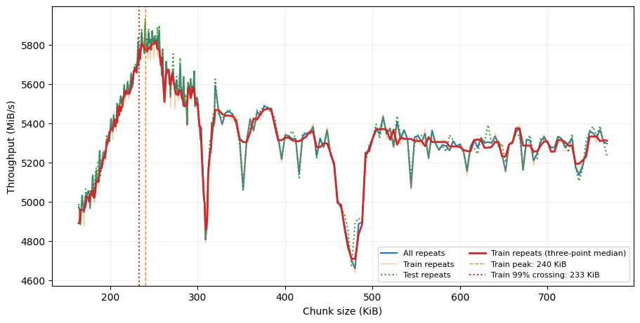
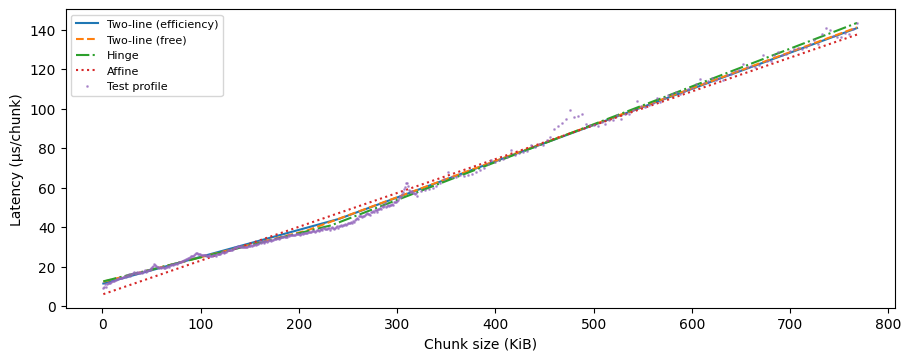
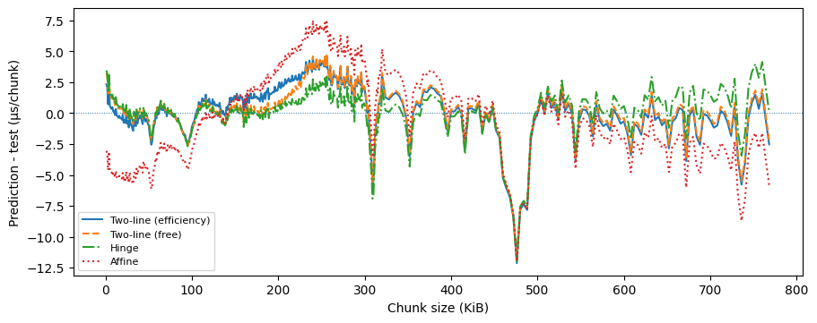

# SSD 처리량 포화를 고려한 타일 기반 선택적 가중치 로딩

## 1. 연구 배경과 목표

### 1.1 SSD의 구조에 대해 Jeong 등이 진행한 연구 (2013)

Jeong 등(2013)의 연구 결과에 따르면, 플래시 메모리는 HDD와 달리 물리적 위치와 무관하게 데이터를 빠르게 접근할 수 있기 때문에, 랜덤 접근에서 균일하고 빠른 속도를 제공하는 장점이 있다. 그러나 단일 플래시 메모리의 지속 읽기/쓰기 속도는 HDD에 비해 느린데, 이것을 보완하기 위해 대부분의 SSD는 다중 채널(multichannel) 및 다중 웨이(multiway) 구조를 채택한다. 

해당 연구진은 IOMeter를 이용해 HDD와 SSD가 처리하는 request size에 따라 throughput이 어떻게 변화하는지를 측정하였다. SSD의 읽기와 쓰기 작업 모두에서, request size가 증가할수록 througput(단위 시간당 처리 용량)이 증가하다가, 특정 request size를 넘어가면 througput이 증가를 멈추는 현상이 발견되었다. 이것은 request size가 커짐에 따라 SSD가 자신의 다중 채널을 병렬적으로 사용하며 채널 활용도를 최대화한 상태에 도달했기 때문이다. 

해당 연구진은 SSD의 쓰기와 읽기 작업에서 이러한 throughput saturation 현상이 어떻게 달라지는지를 분석했다. SSD의 쓰기 작업에서는 순차 접근이 랜덤 접근보다 throughput이 높게 나타나는 모습을 보였다. 그런데 SSD 읽기 작업에서는 순차 접근과 랜덤 접근이 비슷한 request size에서 throughput이 포화되었고, 포화 상태의 throughput 수준도 유사하였다. 

### 1.2 I/O-Efficient Sparsification에 대해 이영기 등이 진행한 연구(2025)

LLM과 같은 모델을 휴대용 하드웨어에서 실행하는 데 있어서의 난점은, 장치의 DRAM 용량이 모델 전체를 담기에 충분하지 않은 경우가 많다는 것이다. 가중치는 플래시에 저장해두고, 중요할 것으로 예상되는 행들을 선별해 DRAM으로 가져오는 Activation Sparsification 방법론에 대한 연구가 진행되어 왔다. 

이영기 등(2025)의 연구팀은 I/O latency가 request size의 절대적인 양에 비례해서 증가할 것이라는 기존 방법론의 전제 조건에 의문을 제기하였다. 같은 양의 가중치를 읽어도, 선택한 행들이 넓은 범위에 듬성하게 분포해 있다면, throughput이 낮아질 수 있다. VLM과 같이 channel의 중요도가 균일하게 분포한 모델 가중치의 경우에서는 그러한 효과가 더 두드러질 수 있다고 논문에서는 주장한다. 

이에 연구진은 모델 가중치의 행들의 물리적 연속성을 반영하여 읽기 지연시간을 예측할 수 있는 chunk-based latency model을 정의하였고,  중요도-지연시간 기반 선택 방법인 Neuron Chunking을 제안하였다. 

가중치 행의 수를 $N$, 선택 mask를 $M\in\{0,1\}^N$라고 하자. $M_i=1$이면 $i$번째 행을 읽는다. 토큰 수가 $H$인 입력에서 $i$번째 채널의 중요도와 mask가 보존하는 중요도를 아래와 같이 정의한다. 

$$
v_i=\frac1H\sum_{t=1}^{H}|a_{t,i}|,
\qquad
I(M)=\sum_{i=0}^{N-1}v_iM_i
$$

$a_{t, i}$는 토큰 $t$의 채널 $i$번째 activation이다. 

mask $M$에서 선택된 행들을 최대 연속 구간으로 분해하고 그 집합을 $\mathcal C(M)$라 하자. 길이가 $l$인 행 구간을 읽는데 걸리는 latency 비용을 $T[l]$로 정의하자. 원 논문의 chunk-based latency 모델은 다음과 같다. 

$$
\widehat L_{\mathrm{table}}(M)
=\sum_{C\in\mathcal C(M)}T[|C|]
$$

연구팀은 각각의 행 구간 길이 $l$에 대해 충분한 수의 같은 크기 chunk를 읽어 처리량이 안정된 조건에서 $T[l]$를 측정하였다. $\widehat L_{\mathrm{table}}$의 정의를 이용하면 $M$에 해당하는 열들을 플래시로부터 읽어오는 데 걸리는 시간을 대략적으로 근사할 수 있다. 

연구팀은 행 예산 $R$ 아래에서의 단위 추정 지연시간당 보존 중요도를 최대화하는 mask $M$을 찾고자 하는 문제를 제안하였다. 

$$
\max_{\substack{M\in\{0,1\}^N\\1\le\|M\|_1\le R}}
\frac{I(M)}{\widehat L_{\mathrm{table}}(M)}.
$$

논문의 Greedy 알고리즘은 중요도–지연시간 비율이 높은 mask $M$을 구성하기 위해 연속 후보 구간들의 집합 $\mathcal G$를 생성한다. 각 후보 $C\in\mathcal G$에 대해

$$
U(C)=\frac{\sum_{i\in C}v_i}{T[|C|]}
$$

를 계산한다. 후보들을 점수가 높은 순서대로 검토하며, 이미 선택한 행과 겹치지 않고 잔여 예산을 넘지 않는 구간을 선택해 mask를 갱신한다.

시작 행이 $j$이고 길이가 $\ell$인 구간 후보를

$$
C_{j,\ell}=\{j,j+1,\ldots,j+\ell-1\},
\qquad 0\le j\le N-\ell
$$

로 정의하자. 

행 단위로 환산한 최소·최대 후보 길이를 $\ell_{\min},\ell_{\max}$, 길이 증가 간격을 $\Delta\ell$, 시작 위치의 이동 간격 상한을 $J$라 하자. 논문이 후보 집합 $\mathcal G$를 구성하기 위해 고려하는 $(j,\ell)$ 쌍은 다음과 같다.

$$
\begin{aligned}
\ell&=\ell_{\min}+k\Delta\ell\le\min(\ell_{\max},N),\\
j&=m\min(\ell,J)\le N-\ell,
\end{aligned}
\qquad k,m=0,1,2,\ldots
$$

이 규칙은 $\ell>J$일 때 같은 길이의 후보 간 중첩을 허용한다. $\ell_{\max}$는 장치의 처리량 포화 지점을 기준으로 정하고, $\ell_{\min}$, $\Delta\ell$, $J$는 탐색의 세밀함과 계산량을 조절하는 매개변수로 사용한다. 

## 2. 문제 정의와 제안 방법

### 2.1 논문에서 제안한 문제의 실제 최적해

논문이 제시한 Neuron Chunking 문제를 생각해보자. 

$$
\max_{\substack{M\in\{0,1\}^N\\1\le\|M\|_1\le R}}
\frac{I(M)}{\widehat L_{\mathrm{table}}(M)}.
$$

$1\le R\le N$이고, 모든 길이 $1\le\ell\le R$에 대해 $T[\ell]>0$이라 하자. 

행 예산 $1\le\|M\|_1\le R$ 아래에서 임의의 최적 mask $M^\star$를 생각하자. $\mathcal C(M^\star)$의 구간들은 선택된 행들을 분할하므로

$$
\begin{aligned}
\frac{I(M^\star)}{\widehat L_{\mathrm{table}}(M^\star)}
&=
\sum_{C\in\mathcal C(M^\star)}
\underbrace{
\frac{T[|C|]}{\widehat L_{\mathrm{table}}(M^\star)}
}_{w_C}
\underbrace{
\frac{\sum_{i\in C}v_i}{T[|C|]}
}_{U(C)}\\
&=
\sum_{C\in\mathcal C(M^\star)}w_CU(C)
\le
\max_{C\in\mathcal C(M^\star)}U(C).
\end{aligned}
$$

$w_C>0$이고 $\sum_Cw_C=1$이므로, 전체 비율은 각 구간의 비율을 latency로 가중한 평균이다. 따라서 가장 큰 구간 비율을 넘을 수 없다.

$U(C)$가 가장 큰 구간 $C^\star\in\mathcal C(M^\star)$만 남긴 mask를 $\widetilde M$이라 하자. 

$$1\le\|\widetilde M\|_1=|C^\star|\le\|M^\star\|_1\le R$$

이므로 $\widetilde M$도 행 예산을 만족한다. 앞선 부등식에 의해 $\widetilde M$의 비율은 $M^\star$보다 작지 않고, $M^\star$의 최적성에 의해 더 클 수도 없다. 따라서 $\widetilde M$도 최적해다.

따라서 단일 연속 구간으로 이루어진 최적해가 존재하며, 원래 문제는 길이가 $R$ 이하인 모든 연속 구간 중 $U(C)$를 최대화하는 구간을 찾는 문제가 된다. 

$$
\max_{\substack{M\in\{0,1\}^N\\1\le\|M\|_1\le R}}
\frac{I(M)}{\widehat L_{\mathrm{table}}(M)}
=
\max_{\substack{1\le\ell\le R\\0\le j\le N-\ell}}
U(C_{j,\ell}).
$$

오른쪽의 비교 대상은 후보 집합 $\mathcal G$에 한정되지 않는 모든 연속 구간이다. 

이러한 현상은 목표함수가 정확히 $R$개의 행을 선택하는 것이 아니라, 행 수의 상한에 제약을 거는 것으로 느슨하게 정의되어 있기 때문에 발생한다. 따라서 본 연구에서는 정확히 $R$개의 행을 선택하는 더 강한 문제에 대해 논의를 이어가고자 한다.

$$
\boxed{
\max_{\substack{M\in\{0,1\}^N\\\|M\|_1=R}}
\frac{I(M)}{\widehat L(M)}.
}
$$

### 2.2 Two-line 지연 모델

#### 2.2.1 연속 구간의 읽기 비용

SSD의 처리량은 요청 크기가 증가함에 따라 증가하다가 일정 수준에서 포화되는 경향을 보인다. 포화 구간의 행당 읽기 비용을 $\alpha>0$라 두면, 길이가 $\ell$행인 I/O 요청의 지연시간을 다음과 같이 근사할 수 있다.

$$
T[\ell]=\alpha\ell,
\qquad \ell\gg1.
$$

작은 요청에서의 처리량 감소를 함께 반영하기 위해, 본 연구에서는 측정표 $T[\ell]$를 다음의 two-line 모델로 근사한다.

길이가 $\ell$행인 구간의 비용을 $T_{\mathrm{2L}}(\ell)$이라 하자. 행 단위로 환산한 전환점을 $\ell_0>0$, 추가 비용의 계수를 $0\le\lambda\le\alpha$라 두면

$$
\boxed{
\begin{aligned}
T_{\mathrm{2L}}(\ell)
&=\alpha\ell+\lambda(\ell_0-\ell)_+\\
&=
\begin{cases}
(\alpha-\lambda)\ell+\lambda\ell_0,
&0<\ell<\ell_0,\\
\alpha\ell,
&\ell\ge\ell_0.
\end{cases}
\end{aligned}
}
$$

여기서 $(x)_+=\max(x,0)$이며, 읽을 행이 없는 경우는 별도로 $T_{\mathrm{2L}}(0)=0$이라 둔다.

이때 두 직선은 $\ell=\ell_0$에서 연속이며, 행 단위 처리량은

$$
\frac{\ell}{T_{\mathrm{2L}}(\ell)}
=
\frac{1}{\alpha+\lambda(\ell_0/\ell-1)_+}
\le\frac1\alpha
$$

이다. $\lambda>0$이면 전환점 이전에는 길이가 늘수록 처리량이 증가하고, 전환점 이후에는 $1/\alpha$로 일정해진다.

모델의 계수 $\alpha,\lambda$와 전환점 $\ell_0$는 SSD 읽기 비용 측정값에 적합하여 결정한다.

#### 2.2.2 고정된 행 예산에서의 전체 읽기 비용

이제 이 모델을 이용해 정확히 $R$개 행을 선택한 mask $M$의 전체 읽기 비용을 살펴보자. 선택한 행 수가 같더라도 연속 구간의 구성에 따라 비용이 달라지며, two-line 모델에서는 이 차이를 짧은 구간의 추가 비용으로 표현할 수 있다.

선행연구의 구간별 비용을 합산하는 구조에 two-line 모델을 적용하자. $\sum_{C\in\mathcal C(M)}|C|=R$이므로 전체 비용은 다음과 같이 분해된다.

$$
\begin{aligned}
\widehat L_{\mathrm{2L}}(M)
&=\sum_{C\in\mathcal C(M)}T_{\mathrm{2L}}(|C|)\\
&=\alpha R
+\lambda\sum_{C\in\mathcal C(M)}(\ell_0-|C|)_+.
\end{aligned}
$$

따라서 같은 $R$에서 모델 비용의 차이는 전환점보다 짧은 구간들의 길이 부족분으로 결정된다. 각 구간은 길이가 $\ell_0$에 도달할 때까지 추가 비용을 줄일 수 있으며, 그 이후에는 추가 비용이 없다.

이 분해를 이용하면 고정된 행 예산에서의 비용 하한도 얻을 수 있다. 모든 구간의 길이가 $R$ 이하이므로 $\sum_C(\ell_0-|C|)_+\ge(\ell_0-R)_+$이고, 따라서

$$
\widehat L_{\mathrm{2L}}(M)
\ge
\alpha R+\lambda(\ell_0-R)_+
=T_{\mathrm{2L}}(R).
$$

길이 $R$의 단일 구간은 이 하한을 달성한다. $\lambda>0$일 때 $R<\ell_0$이면 단일 구간만 하한을 달성하지만, $R\ge\ell_0$이면 모든 구간의 길이가 $\ell_0$ 이상인 mask가 하한을 달성한다. 즉, 여러 구간으로 나뉘어 있더라도 각 구간이 충분히 길면 모델 비용은 동일한 $\alpha R$이다.

한편 행의 배치를 바꾸면 보존 중요도 $I(M)$도 달라진다. 따라서 다음 절에서는 중요도와 짧은 구간의 추가 비용을 함께 고려하는 다음 문제의 최적해를 구한다.

$$
\max_{\substack{M\in\{0,1\}^N\\\|M\|_1=R}}
\frac{I(M)}
{\displaystyle
\alpha R+
\lambda\sum_{C\in\mathcal C(M)}(\ell_0-|C|)_+
}.
$$

### 2.3 동적계획법을 이용한 최적 mask 탐색

앞 절에서 정의한 two-line 비용 모델 아래에서 정확히 $R$개 행을 선택하는 문제를 생각하자. 표기를 줄이기 위해 $T(\ell)=T_{\mathrm{2L}}(\ell)$, $L(M)=\widehat L_{\mathrm{2L}}(M)$이라 쓰고, 최적 비율을

$$
q^\star=
\max_{\substack{M\in\{0,1\}^N\\\|M\|_1=R}}
\frac{I(M)}{L(M)}
$$

이라 하자. 여기서 $1\le R\le N$, $v_i\ge0$이며, 앞 절의 계수 조건에 의해 모든 가능한 mask의 비용은 $L(M)\ge T(R)>0$이다.

비율의 추정값 $q$를 고정하면, 다음의 합 형태 목적함수를 동적계획법(DP)으로 최대화할 수 있다.

$$
F_R(q)=
\max_{\substack{M\in\{0,1\}^N\\\|M\|_1=R}}
\{I(M)-qL(M)\}.
$$

먼저 고정된 $q$에서 이 문제를 푸는 방법을 설명한 뒤, DP 결과를 이용해 $q^\star$를 찾는 과정을 설명한다.

#### 2.3.1 고정된 $q$에서의 DP

행의 인덱스는 $0,\ldots,N-1$로 두고, 중요도의 누적합을 $P_j=\sum_{i=0}^{j-1}v_i$, $P_0=0$으로 정의하자. $D_{z,r}$는 앞의 $z+r$개 행에서 $z$개를 제외하고 $r$개를 선택했을 때의 $I-qL$의 최댓값이다. 필요한 상태의 범위는 $0\le z\le N-R$, $0\le r\le R$이다.

$z\ge1$인 mask에서 마지막으로 선택하지 않은 행을 기준으로 나누자. 그 행 앞에서 선택한 행 수가 $t$라면, 앞부분에는 제외한 행이 $z-1$개, 선택한 행이 $t$개 있다. 마지막으로 제외한 행의 인덱스는 $z+t-1$이고, 그 뒤의 $[z+t,z+r)$는 길이가 $r-t$인 연속 선택 구간이다.

제외한 행이 앞부분과 마지막 구간을 분리하므로 두 부분의 비용을 합산할 수 있다. 마지막 구간의 중요도는 $P_{z+r}-P_{z+t}$이므로

$$
\boxed{
D_{z,r}
=\max_{0\le t\le r}
\left\{
D_{z-1,t}
+P_{z+r}-P_{z+t}
-qT(r-t)
\right\}.
}
$$

$t=r$이면 mask가 선택하지 않은 행으로 끝나며, 마지막 구간은 비어 있다. 이 경우 $T(0)=0$을 사용한다. 모든 mask는 이러한 분해를 가지므로, 모든 $t$를 비교하는 위 점화식은 최적값을 구한다.

제외한 행이 없으면 앞의 $r$개 행을 모두 선택해야 하므로 초기값과 최종값은

$$
D_{0,r}=P_r-qT(r),
\qquad
F_R(q)=D_{N-R,R}
$$

이다. 최적 mask는 $(z,r)=(N-R,R)$에서 역추적한다. 각 상태에서 최댓값을 만드는 $t$를 찾아 $[z+t,z+r)$를 선택하고, $(z,r)\leftarrow(z-1,t)$로 이동한다. $z=0$에 도달하면 남은 앞의 $r$개 행을 모두 선택한다.

#### 2.3.2 Two-line 구조를 이용한 DP 계산

점화식에서 각 상태마다 모든 $t$를 따로 비교하면 계산량이 커진다. Two-line 모델에서는 마지막 구간을 빈 구간, 짧은 구간, 긴 구간으로 나누어 최댓값 계산을 공유할 수 있다.

정수 길이를 구분하기 위한 경계를

$$
h=\min(\lfloor\ell_0\rfloor,R)
$$

로 두자. $1\le r-t\le h$인 경우에는 짧은 구간의 비용식을, $r-t>h$인 경우에는 긴 구간의 비용식을 사용한다. $\ell_0$가 정수이면 경계에서 두 비용식이 같으므로 그 길이를 짧은 구간 쪽에 포함해도 된다. 비용 계산에 쓰는 전환점 $\ell_0$는 반올림하지 않는다.

점화식에서 $t$에 의존하는 항을

$$
\begin{aligned}
A_{z,t}&=D_{z-1,t}-P_{z+t}+q(\alpha-\lambda)t,\\
B_{z,t}&=D_{z-1,t}-P_{z+t}+q\alpha t
\end{aligned}
$$

로 모으면

$$
D_{z,r}=
\max\left\{
\begin{aligned}
&D_{z-1,r},\\
&P_{z+r}-q\bigl((\alpha-\lambda)r+\lambda\ell_0\bigr)
+\max_{\max(0,r-h)\le t<r}A_{z,t},\\
&P_{z+r}-q\alpha r
+\max_{0\le t<r-h}B_{z,t}
\end{aligned}
\right\}.
$$

세 항은 각각 마지막 구간이 비어 있는 경우, 짧은 경우, 긴 경우에 해당한다. 후보가 없는 범위의 최댓값은 $-\infty$로 둔다.

$r$이 증가할 때 $A_{z,t}$를 조회하는 범위는 폭이 $h$인 이동 구간이며, $B_{z,t}$를 조회하는 범위는 오른쪽 끝이 늘어나는 접두 구간이다. 따라서 이동 구간 최댓값과 누적 최댓값을 이용하면, 고정된 $z$에서 모든 $r$의 값을 $O(R+1)$ 시간에 계산할 수 있다.

DP 표의 크기는 $(N-R+1)(R+1)$이다. 역추적에서도 각 $z$마다 최대 $R+1$개의 후보를 비교하므로, 고정된 $q$에서의 DP 계산과 mask 복원에 필요한 시간과 메모리는 모두

$$
O\bigl((N-R+1)(R+1)\bigr)
$$

이다.

#### 2.3.3 최적 비율 $q$의 탐색

가능한 mask $M$에 대해

$$
I(M)-qL(M)
=L(M)\left(\frac{I(M)}{L(M)}-q\right)
$$

이고 $L(M)>0$이므로 다음이 성립한다.

$$
F_R(q)
\begin{cases}
>0,&q<q^\star,\\
=0,&q=q^\star,\\
<0,&q>q^\star.
\end{cases}
$$

최적 비율은 $F_R(q)=0$의 해이다. 이 해를 구하기 위해 Dinkelbach 방법을 사용한다.

길이 $R$의 연속 구간 중 중요도가 가장 큰 mask를 $M_C$, 중요도가 가장 높은 $R$개 행을 선택한 mask를 $M_T$라 하자.

$M_C$의 비용은 $T(R)$이고, 모든 가능한 mask는 $I(M)\le I(M_T)$, $T(R)\le L(M)$을 만족하므로 초기 하한과 상한을

$$
q_0=\frac{I(M_C)}{T(R)}
\le q^\star\le
u_0=\frac{I(M_T)}{T(R)}
$$

로 둔다.

$k$번째 반복에서 $q=q_k$로 DP를 풀고, 복원한 mask를 $M_k$라 하자. $F_R(q_k)=I(M_k)-q_kL(M_k)$을 이용하여 다음 비율을

$$
\boxed{
\begin{aligned}
q_{k+1}
&=\frac{I(M_k)}{L(M_k)}\\
&=\frac{q_kL(M_k)+F_R(q_k)}{L(M_k)}\\
&=q_k+\frac{F_R(q_k)}{L(M_k)}
\end{aligned}
}
$$

로 갱신한다.

$q_k\le q^\star$이면 $F_R(q_k)\ge0$이고, $M_k$도 정확히 $R$개 행을 선택하므로 $q_k\le q_{k+1}\le q^\star$이다. $F_R(q_k)>0$인 동안 비율은 증가하고, $F_R(q_k)=0$이면 $M_k$는 원래 비율 문제의 최적해이다. 가능한 mask의 수는 유한하므로, 정확한 DP 풀이와 산술 연산 아래에서는 유한 번의 반복으로 최적값에 도달한다.

#### 2.3.4 잔차를 이용한 상한의 갱신

임의의 최적 mask $M^\star$에 대해 $I(M^\star)=q^\star L(M^\star)$이다. 

또한 $q^\star-q_k\ge0$이고 $T(R)\le L(M^\star)$이다. 

$F_R(q_k)$의 정의에 의해 $I(M^\star)-q_kL(M^\star)\le F_R(q_k)$이므로

$$
\begin{aligned}
(q^\star-q_k)T(R)
&\le(q^\star-q_k)L(M^\star)\\
&=I(M^\star)-q_kL(M^\star)\\
&\le F_R(q_k).
\end{aligned}
$$

$T(R)>0$으로 나눈 뒤 양변에 $q_k$를 더하면

$$
q^\star
\le q_k+\frac{F_R(q_k)}{T(R)}.
$$

기존 상한 $u_k$와 위 식의 우변은 모두 $q^\star$ 이상이므로 상한을

$$
u_{k+1}
=\min\left\{
u_k,\;
q_k+\frac{F_R(q_k)}{T(R)}
\right\}
$$

로 갱신한다. 각 반복에서 $q_k\le q^\star\le u_k$를 유지하며, $q_0>0$일 때

$$
u_k-q_k\le\varepsilon q_0
$$

이면 반복을 종료한다.

구현에서는 float64 연산과 $\varepsilon=10^{-6}$을 사용한다. DP를 $K$회 호출할 때 DP 계산과 mask 복원에 드는 총 시간은 $O(K(N-R+1)(R+1))$이다.

### 2.4 타일 기반 행 선택

Tiles는 일정 길이의 타일을 단위로 행을 선택하고, 남은 예산을 하나의 연속 구간으로 채운다.

타일 길이를 양의 정수 $B$라 하자. 시작 행을 $0$과 $d=\lfloor B/2\rfloor$로 두면 두 배치의 타일은

$$
\begin{aligned}
\mathcal T_1&=\{C_{0,B},C_{B,B},C_{2B,B},\ldots\},\\
\mathcal T_2&=\{C_{d,B},C_{d+B,B},C_{d+2B,B},\ldots\}
\end{aligned}
$$

이다. 끝 행이 $N-1$을 넘는 타일은 제외하고, 각 배치에서 mask를 독립적으로 구성한다.

행 예산을

$$
R=KB+r,
\qquad
K=\left\lfloor\frac RB\right\rfloor,
\qquad
0\le r<B
$$

로 나누고, 각 배치에서 중요도 $\sum_{i\in C}v_i$가 큰 $K$개 타일을 선택한다.

$r>0$이면 선택한 타일과 겹치지 않는 길이 $r$의 연속 구간 중 중요도가 가장 큰 구간을 추가한다. $R<B$이면 중요도가 가장 큰 길이 $R$의 연속 구간을 선택한다.

예산을 채운 mask 중 $I(M)/L(M)$이 큰 것을 $M_{\mathrm{Tiles}}$로 선택한다.

$B\ge\ell_0$이고 $R\ge B$이면, two-line 모델의 추가 비용은 완전 타일과 합쳐지지 않은 잔여 구간에서만 발생할 수 있다. 따라서

$$
\alpha R
\le L(M_{\mathrm{Tiles}})
\le\alpha(R-r)+T(r).
$$

이다. $r=0$이거나 잔여 구간이 완전 타일과 합쳐지면 $L(M_{\mathrm{Tiles}})=\alpha R$이다. 한편 $B=1$이면 Tiles는 Top-$R$과 같다.

중요도 누적합과 상위 $K$개 타일의 부분 선택을 이용하기 때문에, 고정된 $B$에서 시간 복잡도는 평균 $O(N)$, 메모리 복잡도는 $O(N)$이다.

### 2.5 최소 구간 길이 제약과 최적값의 보장

Two-line 모델에서는 같은 수의 행을 선택하고 모든 구간이 충분히 길면 읽기 비용이 동일해진다. 이 성질을 이용하여 길이 제약 아래에서의 최적화 문제를 정리하고, 중요도 보존율로 원래 최적값에 얼마나 가까운지 평가해 보자.

#### 2.5.1 길이 제약 아래에서의 최적해

정확히 $R$개 행을 선택하는 문제에, 모든 최대 연속 구간 $C\in\mathcal C(M)$의 길이가 $\ell_0$ 이상이어야 한다는 조건을 추가하자. 이 조건이 가능하도록 $\lceil\ell_0\rceil\le R\le N$을 가정한다. 이때 길이 $R$의 단일 구간은 항상 조건을 만족한다.

각 구간은 $T(|C|)=\alpha|C|$를 만족하고, 구간 길이의 합은 $R$이므로 전체 읽기 비용은

$$
\begin{aligned}
L(M)
&=\sum_{C\in\mathcal C(M)}T(|C|)\\
&=\alpha\sum_{C\in\mathcal C(M)}|C|
=\alpha R.
\end{aligned}
$$

따라서 선택한 행의 위치나 구간의 수가 달라도 읽기 비용은 같다. 중요도–지연시간 비율의 분모가 고정되므로, 이 조건 아래에서는 중요도를 최대화하는 mask가 비율도 최대화한다.

그 mask를 $M_{\mathrm{sat}}^\star$, 보존 중요도를 $I_{\mathrm{sat}}=I(M_{\mathrm{sat}}^\star)$이라 하자. 길이 제약 아래에서의 최적 비율은

$$
q_{\mathrm{sat}}
=\frac{I(M_{\mathrm{sat}}^\star)}{L(M_{\mathrm{sat}}^\star)}
=\frac{I_{\mathrm{sat}}}{\alpha R}
$$

이다.

#### 2.5.2 중요도 보존율에 따른 보장

이제 같은 행 예산에서 길이 조건을 두지 않은 문제의 최적 비율 $q^\star$와 비교하자. $M_{\mathrm{sat}}^\star$도 원래 문제에서 선택할 수 있는 mask이므로 $q_{\mathrm{sat}}\le q^\star$이다.

중요도가 가장 높은 $R$개 행을 선택한 Top-$R$ mask를 $M_T$, 그 중요도를 $I_T=I(M_T)$라 하자. 정확히 $R$개 행을 선택한 모든 mask는 $I(M)\le I_T$를 만족한다. 또한 two-line 모델에서 $L(M)\ge\alpha R$이므로

$$
q^\star\le\frac{I_T}{\alpha R}.
$$

$I_T>0$이면 $q^\star>0$이다. 위 상한과 $q_{\mathrm{sat}}=I_{\mathrm{sat}}/(\alpha R)$을 이용하면

$$
\boxed{
\frac{I_{\mathrm{sat}}}{I_T}
\le
\frac{q_{\mathrm{sat}}}{q^\star}.
}
$$

왼쪽은 Top-$R$ 대비 중요도 보존율이고, 오른쪽은 원래 최적 비율 대비 달성률이다. 따라서 길이 제약 아래에서 Top-$R$ 중요도의 $95\%$ 이상을 보존하면, 중요도–지연시간 비율도 원래 최적값의 $95\%$ 이상이다.

이 보장은 원래 최적 mask를 직접 구하지 않고도 $I_{\mathrm{sat}}$과 $I_T$만으로 확인할 수 있다.

## 3. 실험 내용

### 3.1 실험 01 — Chunk 크기에 따른 SSD 읽기 비용

이번 실험에서는 2.2절에서 도입한 two-line 모델이 실험 장치의 읽기 비용을 얼마나 잘 근사하는지 살펴보았다. Chunk 크기별 읽기 비용에 모델을 적합하고, 별도의 반복 측정값으로 오차를 평가하여 3.2절의 알고리즘 비교에 사용할 비용 함수를 정한다.

#### 3.1.1 측정 설정

노트북의 SSD에 저장한 128 MiB 파일을 대상으로, 6개 스레드와 O_DIRECT를 사용하여 읽기 비용을 측정하였다. Chunk 크기는 1–320 KiB에서 1 KiB 간격으로, 324–768 KiB에서 4 KiB 간격으로 정하여 총 432개 크기를 조사하였다.

1.2절에서 설명한 비용 측정 방식에 따라, 동일한 크기의 chunk 수를 늘리면서 처리량을 측정하였다. 각 chunk 사이에는 32 KiB를 비워 두었다. 각 읽기 조건에서 3회 warmup 후 10회 측정한 시간의 중앙값을 사용하고, 처리량의 변화가 작아지는 구간을 찾아 대표 처리량을 추정하였다.

전체 크기 범위에 대한 측정은 7회 반복하였다. 각 반복에서는 크기를 방문하는 순서를 무작위로 섞어, 항상 같은 순서로 측정할 때 발생할 수 있는 영향을 줄였다.

요청 크기를 $z$ KiB, 반복 $t$에서 추정한 처리량을 $\widehat\beta_t(z)$ MiB/s라 하자. 이를 chunk당 읽기 비용으로 환산하면

$$
T_t(z)=\frac{1000z}{1024\widehat\beta_t(z)}
\qquad \mathrm{ms/chunk}
$$

이다. 이후 모델에 적합하는 값은 이처럼 배치 처리량으로 환산한 chunk당 비용이다. 처리량 계산에는 O_DIRECT 정렬을 위한 padding을 제외한 논리적 요청 크기를 사용하였다.

#### 3.1.2 모델의 적합과 평가

7회 반복 중 앞의 4회로 모델을 적합하고, 나머지 3회로 오차를 평가하였다. 각 요청 크기에서 적합용 반복의 중앙값을 $T_{\mathrm{train}}(z)$, 평가용 반복의 중앙값을 $T_{\mathrm{test}}(z)$라 하자. 모델의 계수와 전환점은 모두 적합용 자료만으로 결정하였다.

모델 적합에는 행 수 대신 요청 크기 $z$를 사용한다. 2.2절의 $\alpha,\lambda,\ell_0$에 대응하는 KiB 단위 계수와 전환점을 각각 $\alpha_z,\lambda_z,z_0$라 하자. 가중치 한 행의 크기가 $w$ KiB이면 $z=w\ell$이므로, 행 단위 모델과는 다음 관계를 갖는다.

$$
\alpha=w\alpha_z,
\qquad
\lambda=w\lambda_z,
\qquad
\ell_0=\frac{z_0}{w}.
$$

2.2절의 계수 제약을 유지하면서, 측정한 각 크기를 전환점 후보로 두고 비음수 최소제곱법으로 계수를 적합하였다. 그중 적합용 RMSE가 가장 작은 전환점을 선택하였다. 모든 크기에 같은 가중치를 부여하였으므로, 측정 간격이 촘촘한 320 KiB 이하 구간이 더 많은 관측값을 제공한다.

비교 모델로는 연속된 두 직선으로 구성된 hinge 모델과, 하나의 직선으로 구성된 affine 모델을 사용하였다.

$$
\begin{aligned}
T_{\mathrm H}(z)&=a_{\mathrm H}+b_{\mathrm H}z+c_{\mathrm H}(z-z_{\mathrm H})_+,\\
T_{\mathrm A}(z)&=a_{\mathrm A}+b_{\mathrm A}z.
\end{aligned}
$$

Hinge 모델은 큰 요청에서 비용이 요청 크기에 정비례해야 한다는 제약을 두지 않는다. Hinge의 전환점도 적합용 RMSE로 선택하였다.

평가는 적합된 모델의 예측값과 $T_{\mathrm{test}}(z)$를 비교하여 수행하였다. RMSE는 비용 예측의 절대적인 오차 크기를, MAPE는 측정 비용 대비 절대 오차의 평균 비율을 나타낸다. 적합과 평가는 같은 432개 요청 크기를 사용하며, 반복 측정 자료를 분리하였다.

#### 3.1.3 결과와 해석

그림 3.1-1은 요청 크기별 처리량 중 포화 부근을 보여준다. 적합용 자료에서 처리량이 가장 높은 측정 크기는 240 KiB였다. 처리량에 3점 이동 중앙값을 적용한 뒤 최고값의 99%에 처음 도달한 크기는 233 KiB였다.

<figure style="width: 80%; max-width: 560px; margin: 1.1em auto; break-inside: avoid; page-break-inside: avoid;">
  
  <figcaption style="margin-top: 0.4em; font-size: 0.85em; line-height: 1.45; text-align: left;"><em>그림 3.1-1. 전체·적합용·평가용 반복의 읽기 비용 중앙값으로 환산한 처리량. 수직선은 적합용 자료의 최고 처리량 위치와, 3점 이동 중앙값을 적용한 처리량의 99% 도달 위치를 나타낸다.</em></figcaption>
</figure>

Two-line 모델의 적합 전환점은 208 KiB로 선택되었다. 이 값은 전체 측정 크기에 대한 적합 오차를 최소화한 결과이며, 위의 두 처리량 지표와는 구분한다. 적합된 비용 계수는

$$
\alpha_z\approx0.183823\;\mathrm{\mu s/KiB},
\qquad
\lambda_z\approx0.058754\;\mathrm{\mu s/KiB}
$$

이다.

그림 3.1-2는 평가용 측정값과 각 모델의 예측 곡선을 비교한다. 표에는 전환점을 적합한 two-line 및 hinge 모델과 affine 모델의 오차를 정리하였다.

<figure style="width: 80%; max-width: 560px; margin: 1.1em auto; break-inside: avoid; page-break-inside: avoid;">
  
  <figcaption style="margin-top: 0.4em; font-size: 0.85em; line-height: 1.45; text-align: left;"><em>그림 3.1-2. 요청 크기별 읽기 비용의 측정값과 모델 예측. Test profile은 평가용 반복의 중앙값이다. Two-line (free)는 표의 Two-line 모델이며, Two-line (efficiency)는 전환점을 최고 처리량 크기인 240 KiB로 고정한 비교 설정이다.</em></figcaption>
</figure>

| 모델 | 전환점 (KiB) | 적합 RMSE (µs) | 평가 RMSE (µs) | 평가 MAPE (%) |
| --- | ---: | ---: | ---: | ---: |
| Two-line | 208 | 2.076 | 2.043 | 3.415 |
| Hinge | 233 | 1.814 | 1.731 | 2.707 |
| Affine | — | 3.887 | 3.909 | 10.467 |

Two-line 모델은 affine 모델보다 작은 평가 오차를 보였으며, 평가 RMSE는 2.043 µs, MAPE는 3.415%였다. 적합 RMSE와 평가 RMSE도 비슷하여, 적합에 사용하지 않은 반복 측정에서도 유사한 근사 정확도를 보였다. 다만 비교 모델 중 평가 오차가 가장 작은 것은 hinge 모델이었다.

크기별 오차를 더 자세히 보기 위해, 그림 3.1-3에 예측값에서 평가용 측정값을 뺀 잔차를 나타내었다. 예를 들어 약 480 KiB에서는 여러 모델이 실제 읽기 비용을 낮게 예측하며, 이는 그림 3.1-1에서 나타난 처리량 하락과 대응한다.

<figure style="width: 80%; max-width: 560px; margin: 1.1em auto; break-inside: avoid; page-break-inside: avoid;">
  
  <figcaption style="margin-top: 0.4em; font-size: 0.85em; line-height: 1.45; text-align: left;"><em>그림 3.1-3. 요청 크기별 예측 잔차. 양수는 읽기 비용의 과대 예측, 음수는 과소 예측을 의미한다.</em></figcaption>
</figure>

이처럼 실측 처리량에는 요청 크기에 따른 국소적인 변동이 남아 있다. 2.2절에서 둔 일정한 포화 처리량은 이러한 변동을 단순화한 근사 조건이며, 이 실험에서는 그에 따른 오차를 평가하였다.

### 3.2 실험 02 — 비용 모델에서의 선택 알고리즘 비교

이번 실험에서는 3.1절에서 적합한 two-line 모델을 사용하여, Global DP, Paper, Tiles, Top-$R$의 보존 중요도와 추정 읽기 비용을 비교하였다. 2.3절의 Global DP를 고정 행 예산에서의 비율 최적해로 두고, 각 선택 방법이 이 기준에 얼마나 가까운지 살펴본다. 이 절의 지연시간은 비용 모델의 추정값이며, 행을 선택하는 계산 시간과 실제 SSD 읽기 시간은 3.3절에서 다룬다.

#### 3.2.1 입력 자료와 비용 모델

Qwen2.5-0.5B-Instruct에 세 개의 텍스트 입력을 주고, attention과 MLP의 projection에 들어가는 activation을 수집하였다. 입력은 연속적인 플래시 읽기, 신경망의 희소성과 정확도, 이동 평균 함수 작성을 각각 다룬다. 행을 제외하지 않은 forward에서 채널별 activation 절댓값의 평균을 구하고, 원래 채널 순서를 유지한 중요도 벡터를 trace로 저장하였다.

총 504개 trace를 사용하였다. 가중치는 원소당 2바이트이며, 입력 채널별 가중치를 한 행으로 배열했을 때 행 수를 $N$, 행당 원소 수를 $D$라 하자. Shape별 trace 수와 행 단위 전환점은 다음과 같다.

| $N\times D$ | Trace 수 | 한 행의 크기 (KiB) | 전환점 $\ell_0$ (행) |
| --- | ---: | ---: | ---: |
| $896\times128$ | 144 | 0.25 | 832.00 |
| $896\times896$ | 144 | 1.75 | 118.86 |
| $896\times4864$ | 144 | 9.50 | 21.89 |
| $4864\times896$ | 72 | 1.75 | 118.86 |

모든 방법에 3.1절의 전환점 208 KiB인 two-line 모델을 적용하였다. 행당 크기에 따라 계수와 전환점을 행 단위로 환산하고, 선택된 행들을 최대 연속 구간으로 합친 뒤 각 구간의 비용을 더하여 $L(M)$을 계산하였다. 3.1절에서 측정한 768 KiB보다 큰 구간에도 모델의 포화 이후 직선을 연장하여 적용하였다.

각 trace에서 요청 행 비율을 $f\in\{0.1,0.2,\ldots,0.9\}$로 바꾸며

$$
R=\max\{1,\lfloor fN\rfloor\}
$$

개의 행을 예산으로 주었다. 따라서 Global DP의 비교 기준은 총 $504\times9=4{,}536$개이다.

#### 3.2.2 비교 방법과 평가 지표

Global DP는 정확히 $R$개 행을 선택하면서 $I(M)/L(M)$을 최대화한다. 2.3절의 DP와 비율 갱신을 사용하며, 종료 허용오차는 $10^{-6}$으로 두었다. Top-$R$은 중요도가 가장 큰 $R$개 행을 선택한다.

Tiles는 2.4절의 두 배치와 잔여 구간 선택을 사용한다. 타일 길이는 전환점의 $1$, $1.25$, $1.5$, $1.75$, $2$배를 각각 올림한 값과, 전환점을 반복해서 절반으로 나눈 뒤 올림한 값들을 사용하였다. 같은 정수 길이는 한 번만 평가하고, $B=1$인 경우는 Top-$R$로 표시하였다.

Paper는 1.2절의 greedy 방법에 동일한 two-line 비용을 제공하였다. 후보 길이의 시작값과 증가 간격, 시작 위치의 이동 간격 상한은 각각 8 KiB로 설정하였다. $4864\times896$에서는 앞의 두 값을 12 KiB, 이동 간격 상한을 16 KiB로 두었다. 최대 후보 크기는 3.1절의 처리량 99% 도달 크기인 233 KiB를 기준으로 설정하였다.

Global DP, Tiles, Top-$R$은 예산을 모두 채우지만, Paper는 더 적은 행을 선택할 수 있다. 저장된 결과에서도 Paper는 4,536개 조건 중 2,520개에서 예산을 덜 사용하였다. 이후 비교는 같은 요청 예산에 대한 결과이며, 각 방법이 실제로 반환한 mask의 중요도와 비용을 사용한다. 정확히 $R$개 행을 선택하는 DP의 최적값이 예산을 덜 채운 Paper의 비율까지 항상 제한하는 것은 아니다.

보존 중요도는 전체 중요도에 대한 비율 $100I(M)/\sum_i v_i$로 나타내었다. DP 대비 비율은 같은 trace와 요청 예산에서 각 방법의 $I(M)/L(M)$을 DP의 비율로 나누어 백분율로 표시하였다. 표에서는 각 지표의 trace 간 중앙값을 사용한다. 특히 DP 대비 비율은 trace별로 먼저 나눈 뒤 중앙값을 구하므로, 중요도 중앙값과 지연시간 중앙값을 나눈 값과는 구분한다.

#### 3.2.3 중요도와 추정 읽기 비용

그림 3.2-1은 $896\times896$에서 요청 예산을 바꾸었을 때의 결과이다. 각 점은 하나의 trace이며, 같은 예산에서 중요도와 지연시간의 중앙값을 각각 구하여 연결하였다. 점선은 Global DP의 중앙값을 나타낸다. 이 곡선은 예산별 결과의 요약이며, 모든 중요도 수준에 대한 최소 지연시간 경계를 의미하지 않는다.

<figure style="width: 90%; max-width: 680px; margin: 1.1em auto; break-inside: avoid; page-break-inside: avoid;">
  
  <figcaption style="margin-top: 0.4em; font-size: 0.85em; line-height: 1.45; text-align: left;"><em>그림 3.2-1. 요청 행 비율에 따른 보존 중요도와 two-line 추정 읽기 비용. 색은 요청 비율을 나타내며, 그림의 s는 행 단위 전환점이다. Baseline/coarse와 fine 패널은 서로 다른 가로축 범위를 사용하고, 가로축은 로그 척도이다.</em></figcaption>
</figure>

요청 비율이 50%일 때는 $R=448$이다. 이 예산에서 네 방법의 결과를 정리하면 다음과 같다. Tiles는 $B=\lceil\ell_0\rceil=119$인 설정을 사용하였다.

| 방법 | 보존 중요도 (%) | 추정 읽기 비용 (ms) | DP 대비 비율 (%) |
| --- | ---: | ---: | ---: |
| Global DP | 58.44 | 0.1441 | 100.00 |
| Paper | 58.97 | 0.1483 | 96.82 |
| Tiles ($B=119$) | 56.32 | 0.1470 | 95.87 |
| Top-$R$ | 72.48 | 2.6400 | 7.22 |

Top-$R$은 중요도를 가장 많이 보존하지만, 추정 읽기 비용도 크게 나타났다. 반면 Tiles는 일부 중요도를 포기하면서 읽기 비용을 DP에 가까운 수준으로 낮추었다. 이 조건에서 Tiles의 DP 대비 비율 중앙값은 95.87%였다. Paper는 Tiles보다 중요도를 더 많이 보존하고 읽기 비용도 조금 높았으며, 비율 중앙값은 96.82%로 Tiles보다 높았다.

같은 50% 예산에서 다른 shape의 결과도 비교하였다. 아래 표에서 Tiles의 길이는 각 shape의 $B=\lceil\ell_0\rceil$이다.

| $N\times D$ | Paper의 DP 대비 비율 (%) | Tiles의 DP 대비 비율 (%) | Top-$R$의 DP 대비 비율 (%) |
| --- | ---: | ---: | ---: |
| $896\times128$ | 99.72 | 100.00 | 1.30 |
| $896\times896$ | 96.82 | 95.87 | 7.22 |
| $896\times4864$ | 97.51 | 95.78 | 26.60 |
| $4864\times896$ | 98.68 | 96.46 | 6.10 |

$896\times128$을 제외한 세 shape에서 Tiles는 DP 비율의 약 95.8–96.5%를 중앙값으로 달성하였다. 이 수치는 해당 예산과 trace에서 관찰한 결과이며, 2.5절의 중요도 보존율에 따른 보장과는 구분한다. 또한 이 예산에서는 세 shape 모두 Paper의 비율 중앙값이 Tiles보다 높았다. 선택 계산 비용까지 포함했을 때의 관계는 3.3절에서 확인한다.

#### 3.2.4 구간 길이와 타일 크기의 영향

그림 3.2-2는 같은 $896\times896$, 50% 예산에서 선택된 최대 연속 구간의 길이 분포이다. 인접한 타일은 하나의 구간으로 합쳐지므로, 가로축의 구간 길이는 타일 길이와 반드시 같지는 않다. 각 구간의 빈도는 전체 trace 수로 나누어, trace당 평균 구간 수로 나타내었다.

<figure style="width: 90%; max-width: 680px; margin: 1.1em auto; break-inside: avoid; page-break-inside: avoid;">
  
  <figcaption style="margin-top: 0.4em; font-size: 0.85em; line-height: 1.45; text-align: left;"><em>그림 3.2-2. 방법별 최대 연속 구간의 길이 분포. 점선은 전환점 118.86행을 나타낸다. 가로축은 로그 척도이며, 세로축은 trace당 구간 수 1까지 선형, 그 이상은 로그 척도이다.</em></figcaption>
</figure>

Top-$R$의 구간은 주로 짧은 길이에 분포한다. Trace별 구간 수의 중앙값은 Top-$R$에서 208개, Global DP와 $B=119$인 Tiles에서 각각 3개였다. 2.2절의 비용 분해에 따르면, 같은 $R$에서 이 차이는 짧은 구간에 부과되는 추가 비용으로 이어진다.

타일을 작게 하면 중요도가 높은 행들을 더 세밀하게 선택할 수 있지만, 포화 길이에 못 미치는 구간도 늘어날 수 있다. 예를 들어 $B=119$에서 $B=30$으로 줄이면 보존 중요도의 중앙값은 56.32%에서 60.61%로 증가하지만, 읽기 비용은 0.1470 ms에서 0.1958 ms로 증가하였다. DP 대비 비율 중앙값은 95.87%에서 75.69%로 낮아졌다. 반대로 타일을 크게 하면 선택 위치의 자유도가 줄고 잔여 예산도 달라지므로, 타일 크기에 따라 비율이 한 방향으로만 변하지는 않았다.

$896\times128$은 별도로 해석할 필요가 있다. 행렬 전체는 224 KiB로 two-line 전환점 208 KiB보다 조금 크지만, 실험의 최대 선택 예산은 806행, 즉 201.5 KiB이다. 따라서 모든 요청 예산이 $R<\ell_0=832$를 만족한다. 전체 크기는 처리량 99% 도달 크기인 233 KiB보다도 작다.

이 shape에서 $B=\lceil\ell_0\rceil$인 Tiles는 항상 $R<B$이므로, 중요도가 가장 큰 길이 $R$의 단일 구간을 선택한다. 저장된 DP 결과도 모든 trace와 예산에서 같은 중요도와 비용의 단일 구간 해를 반환하였다. 따라서 앞 표의 100%는 포화 길이의 타일 여러 개를 선택한 결과가 아니라, 선택 예산이 전환점보다 작은 조건에서 단일 구간 선택이 DP와 일치한 결과이다. $896\times896$에서도 10% 예산은 $R=89<\ell_0$에 해당하지만, 나머지 예산에서는 전환점보다 많은 행을 선택한다.

이번 비교에서는 전환점 부근의 타일을 사용하여 짧은 구간의 추가 비용을 줄이는 효과를 확인하였다. 이 결과는 two-line 비용 모델과 수집한 중요도 trace에 대한 것이며, 실제 읽기 시간에서의 효과는 다음 실험에서 살펴본다.

<!--
작성 근거: 기존 노트북의 코드와 저장된 결과를 읽어 작성하였으며 실험은 재실행하지 않았다.
입력 수집: ../results/02/02_01_capture_traces.ipynb
비율 최적해: ../results/02/02_02_global_oracle.ipynb
선택 방법과 설정: ../results/02/02_03_selector_sweep.ipynb
그림 3.2-1: ../results/02/02_04_analyze_oracle.ipynb, cells[16].outputs[1].data[image/png]
그림 3.2-2: ../results/02/02_05_chunk_lengths.ipynb, cells[18].outputs[1].data[image/png], FRACTION = 0.5
두 PNG는 저장된 출력에서 그대로 추출하였다.
표와 본문의 수치: ../results/02/oracle_reference.csv 및 selector_results.csv
보존 중요도 = 100 * importance / importance_total.
DP 대비 비율 = 100 * (importance / latency) / (DP importance / DP latency).
DP 결과는 trace_id와 fraction으로 대응시키고, shape·방법·예산별 중앙값을 구하였다.
구간 수는 intervals의 길이, 선택 행 수는 각 [start, end) 구간의 end - start 합이다.
-->

### 3.3 실험 03 — 실제 선택 시간과 SSD 읽기 시간 비교

## 4. 중간 결론과 향후 계획

- [ ] 세 실험에서 현재까지 확인한 결과를 정리한다.
- [ ] 아직 확인하지 못한 주장과 실험의 한계를 정리한다.
- [ ] 보존 중요도와 실제 모델 정확도의 관계를 검증할 계획을 적는다.
- [ ] 전체 추론 시간에 미치는 영향을 검증할 계획을 적는다.
- [ ] 후속 실험의 우선순위와 예상 일정을 정한다.

## 5. 재현 자료

- [ ] 실험별 실행 순서와 환경을 정리한다.
- [ ] 그림과 표에 사용한 노트북 및 결과 파일을 연결한다.
- [ ] 보고서에 사용한 결과의 실행 시점과 설정을 기록한다.
